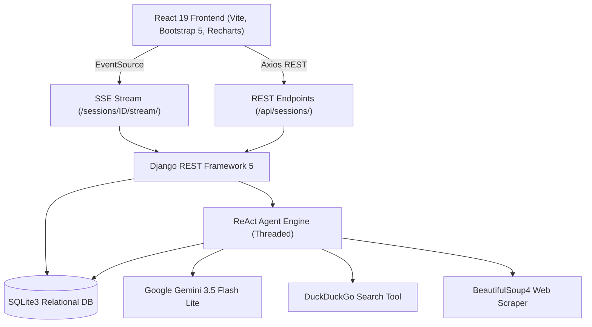

# ⚡ AutoResearch Agent — Full-Stack Autonomous Intelligence Platform

An enterprise-grade, autonomous ReAct (Reasoning + Acting) Agentic AI application built with **React 19**, **Bootstrap 5**, **Recharts**, and **Django REST Framework**, powered by **Google Gemini 3.5 Flash Lite**.

---

## 🚀 Key Features

- **Autonomous ReAct Agent Loop**: Iteratively reasons, plans, and selects external actions (DuckDuckGo web searches, BeautifulSoup4 web page scraping) before synthesizing final reports.
- **Server-Sent Events (SSE) Live Streaming**: Real-time push of cognitive agent steps (`thought`, `action`, `observation`) using Django's `StreamingHttpResponse` and the browser `EventSource` API.
- **Dynamic Benchmark Visualization**: Automatic LLM metric extraction converted directly into high-contrast interactive bar charts via `Recharts`.
- **Retrieval-Grounded Follow-Up Q&A**: Contextual drawer enabling users to ask follow-up questions strictly grounded in scraped session observations, preventing hallucinations.
- **Dual-Matrix Comparison Mode**: Side-by-side comparison interface for contrasting multiple research session reports and benchmark metrics simultaneously.
- **Word-Style Multi-Page PDF Export**: Engineered `@media print` CSS engine with fixed positioning frames ensuring clean, closed borders across every single exported page.
- **Industrial Monolith High-Contrast UI**: Obsidian/slate theme designed with strict WCAG contrast standards, toggleable between Dark and Light mode without breaking component visibility.

---

## 🛠️ Architecture & Tech Stack



- **Frontend**: React 19, Vite, Bootstrap 5, Bootstrap Icons, Recharts, React-Markdown, Axios.
- **Backend**: Django 5.x, Django REST Framework, Django-CORS-Headers, SQLite.
- **Agent Intelligence**: Google Gemini 3.5 Flash Lite (`google-genai` SDK), custom ReAct execution loop, exponential backoff retries (429/503 mitigation).
- **Tools**: DuckDuckGo Search (`duckduckgo_search`), Web Scraper (`beautifulsoup4` + `requests`).

---

## 📦 Setup & Installation

### 1. Prerequisites
- Python 3.10+
- Node.js 18+ & npm
- Google Gemini API Key ([Get it from Google AI Studio](https://aistudio.google.com/))

### 2. Backend Setup
```bash
# Clone the repository
git clone https://github.com/<your-username>/research-agent-fullstack.git
cd research-agent-fullstack

# Activate virtual environment
# Windows:
.\venv\Scripts\Activate.ps1
# Linux/macOS:
source venv/bin/activate

# Install dependencies
pip install django djangorestframework django-cors-headers requests beautifulsoup4 duckduckgo-search python-dotenv google-genai

# Configure environment variables
copy .env.example .env
# Edit .env and insert your GEMINI_API_KEY

# Run database migrations
python manage.py migrate

# Start backend server
python manage.py runserver
```
Backend runs at: `http://127.0.0.1:8000/`

### 3. Frontend Setup
```bash
cd frontend

# Install dependencies
npm install

# Start Vite dev server
npm run dev
```
Frontend runs at: `http://localhost:5173/`

---

## 📄 Documentation & Interview Preparation Guide

A technical dossier and interview defense guide is provided directly in the root directory:
- **`PROJECT_DOCUMENTATION.md`**: Full Markdown guide detailing architecture, schema, SSE vs WebSocket trade-offs, and resume bullet points.
- **`PROJECT_DOCUMENTATION.html`**: Formatted document. Open this file in Google Chrome / Edge and press `Ctrl + P` to save a clean PDF.
